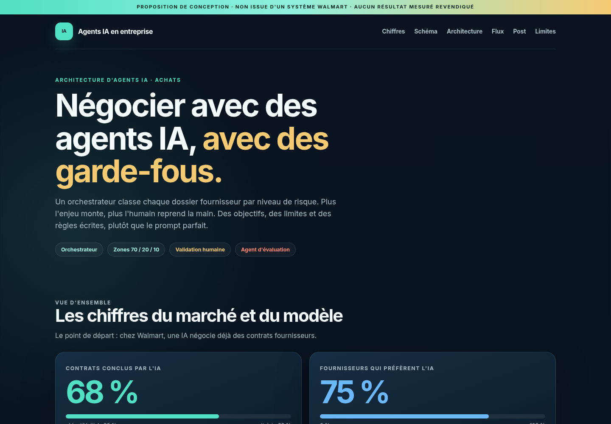

# Agents IA en entreprise

[Ouvrir la page en ligne](https://didier-lioniello.github.io/agents-ia-entreprise/).

> **PROPOSITION DE CONCEPTION · NON ISSUE D'UN SYSTÈME WALMART**
> Aucun résultat mesuré n'est revendiqué. Rien n'est publié sur les réseaux sociaux depuis ce dépôt.

Ce dépôt présente une architecture d'agents IA pour la négociation de contrats fournisseurs, supervisée par niveau de risque : un orchestrateur répartit les dossiers en trois zones (70 / 20 / 10 %), chaque zone a son contrôle humain, trois listes de règles encadrent les agents et un agent d'évaluation ajuste le système. C'est une proposition de Didier Lioniello (Applied AI Architect).

La page [`index.html`](index.html) est statique : pas d'API, pas de CDN, pas de traceur. Une Content Security Policy stricte n'autorise que la feuille de style, le script et les images locaux.



## Vue d'ensemble

| Indicateur | Valeur |
|---|---|
| Contrats conclus par l'IA chez Walmart | 68 % (objectif : 20 %) |
| Fournisseurs qui préfèrent négocier avec l'IA | 75 % |
| Zones de risque du modèle | 3 (70 % faible, 20 % complexe, 10 % stratégique) |
| Étapes du flux | 4 (Recevoir, Qualifier, Négocier, Évaluer) |
| Listes de règles | 3 (toujours faire, demander d'abord, ne jamais faire) |
| Validation humaine obligatoire | 1 (gros montants, toutes zones) |

Seuls les deux premiers chiffres concernent Walmart ; le reste décrit la conception proposée.

## Architecture

Détail : [`docs/architecture.md`](docs/architecture.md) · flux : [`docs/workflow.md`](docs/workflow.md) · règles : [`docs/regles-agents.md`](docs/regles-agents.md) · schéma et Mermaid : [`schema-agents-ia.md`](schema-agents-ia.md).

## Contenu de la page

1. Vue d'ensemble des chiffres
2. Le schéma visuel (2400 × 2400 et 1200 × 1200)
3. Architecture : orchestrateur, zones 70 / 20 / 10, validation des gros montants, règles, agent d'évaluation
4. Flux de travail en quatre étapes et diagramme en HTML/CSS
5. Post LinkedIn (brouillon, non publié) avec bouton de copie
6. Limites et honnêteté

## Voir en local

```bash
git clone https://github.com/didier-lioniello/agents-ia-entreprise.git
cd agents-ia-entreprise
python3 -m http.server 8000   # puis http://localhost:8000
```

Ouvrir `index.html` directement fonctionne aussi.

## Générer le visuel

Le visuel carré vient de [`infographic.html`](infographic.html), rendu avec Chrome sans interface :

```bash
google-chrome --headless=new --hide-scrollbars --window-size=1200,1200 \
  --force-device-scale-factor=2 --screenshot=schema-agents-ia-linkedin.png infographic.html
```

`make_schema.py` (Pillow) régénère l'ancienne figure rectangulaire `schema-agents-ia.png`.

## Organisation du dépôt

```text
index.html, styles.css, app.js     page de présentation
schema-agents-ia-linkedin*.png     visuel carré (2400 et 1200)
schema-agents-ia.png               figure rectangulaire
infographic.html, make_schema.py   sources des visuels
schema-agents-ia.md                détail du schéma et Mermaid
post-linkedin-schema.md            texte du post LinkedIn (brouillon)
docs/                              architecture, flux, règles, aperçu
```

## Limites connues

- Proposition de conception, pas l'architecture réelle de Walmart, qui n'est pas publique.
- La répartition 70 / 20 / 10 et les seuils sont des hypothèses à tester.
- Aucun résultat mesuré n'est revendiqué pour ce modèle.

## Licence

[MIT](LICENSE) © 2026 Didier Lioniello
