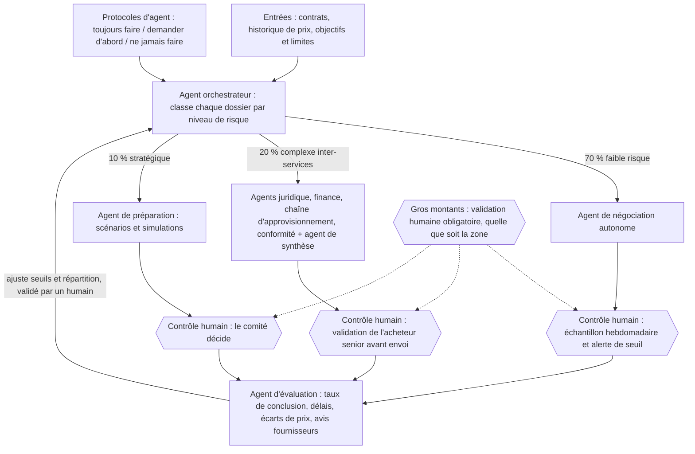

# Architecture du système

Proposition de conception de Didier Lioniello (Applied AI Architect). Ce n'est pas l'architecture réelle de Walmart.

## Composants

| Composant | Rôle | Contrôle humain |
|---|---|---|
| Agent orchestrateur | Reçoit contrats, historique de prix, objectifs et limites ; classe chaque dossier par niveau de risque | Seuils et répartition validés par un humain |
| Zone 70 % faible risque | Agent de négociation autonome, dans des limites écrites | Échantillon relu chaque semaine, alerte de seuil |
| Zone 20 % complexe | Agents juridique, finance, logistique, conformité + agent de synthèse | L'acheteur senior valide avant l'envoi |
| Zone 10 % stratégique | Agent de préparation : scénarios et simulations | Le comité décide |
| Gros montants | Règle transverse | Validation humaine obligatoire, toutes zones |
| Agent d'évaluation | Mesure conclusion, délais, écarts de prix, avis fournisseurs ; propose des ajustements | Chaque ajustement est validé par un humain |

Règles des agents : voir [regles-agents.md](regles-agents.md).

## Diagramme

