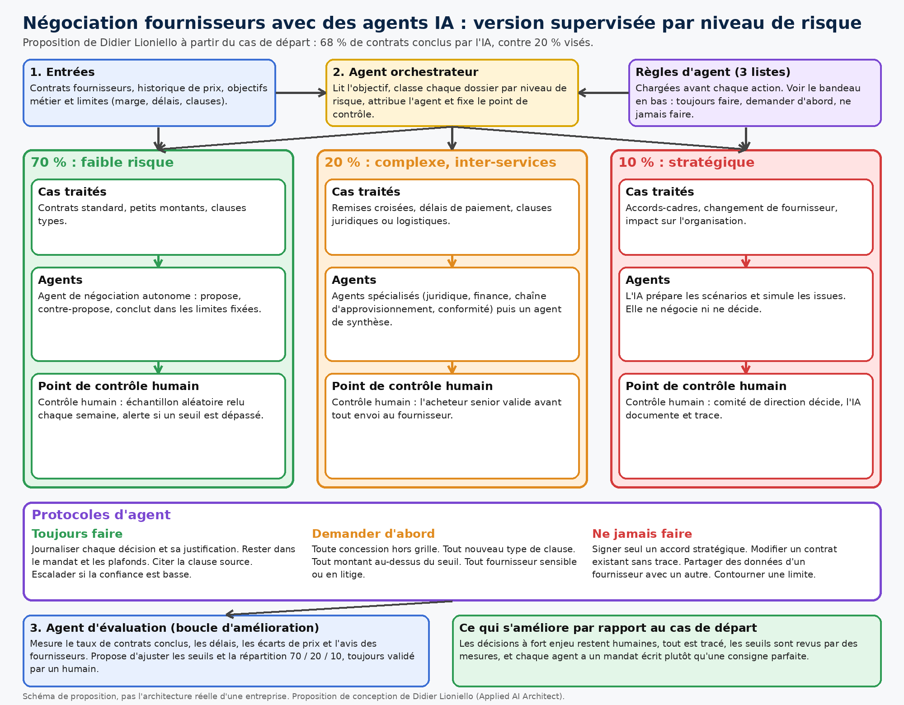
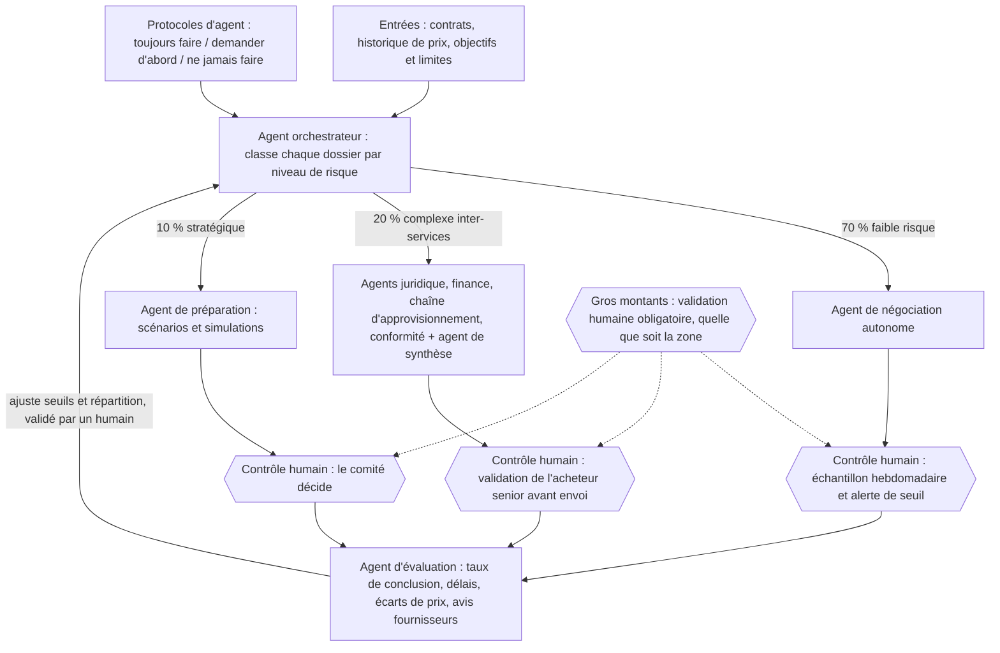

# Schéma d'une application d'agents IA : négociation fournisseurs supervisée

**Statut : brouillon, rien n'est publié.**

## Cas de départ

Chez un grand distributeur, une IA négocie les contrats fournisseurs : l'objectif était de conclure 20 % des contrats ; l'IA en a conclu 68 %, et 75 % des fournisseurs ont préféré négocier avec elle, car c'était plus rapide.

La répartition par niveau de risque 70 / 20 / 10, les trois listes de règles (toujours faire, demander d'abord, ne jamais faire) et l'ensemble du workflow sont **une proposition de conception de Didier Lioniello (Applied AI Architect)**, pas l'architecture réelle d'une entreprise, qui n'est pas publique.

Diagramme principal (rendu fidèle du Mermaid ci-dessous) : [schema-agents-ia-diagramme.png](schema-agents-ia-diagramme.png) (3000×2100), [version 1400](schema-agents-ia-diagramme-1400.png), source [diagramme.html](diagramme.html).

Visuel carré LinkedIn : [schema-agents-ia-linkedin.png](schema-agents-ia-linkedin.png) (2400×2400) et [version 1200×1200](schema-agents-ia-linkedin-1200.png).

## Version Mermaid

## Protocoles d'agent

- **Toujours faire** : journaliser chaque décision et sa justification ; rester dans le mandat et les plafonds ; citer la clause source ; escalader si la confiance est basse.
- **Demander d'abord** : toute concession hors grille ; tout nouveau type de clause ; tout montant au-dessus du seuil ; tout fournisseur sensible ou en litige.
- **Ne jamais faire** : signer seul un accord stratégique ; modifier un contrat existant sans trace ; partager les données d'un fournisseur avec un autre ; contourner une limite.

## Ce qui est amélioré par rapport au cas de départ

- Les décisions à fort enjeu restent humaines (10 % stratégique), les cas intermédiaires sont validés avant envoi.
- Chaque agent a un mandat écrit, au lieu d'un prompt parfait.
- Tout est tracé, ce qui permet un audit.
- Un agent d'évaluation revoit les seuils à partir de mesures, avec validation humaine.

Limites : ce sont des choix de conception à tester, pas des résultats mesurés.

## Style

Visuel reconstruit dans le langage visuel du tableau de bord RevenueOps-360 de Didier (`docs/index.html`, `docs/styles.css`) : fond encre #08131F avec halos radiaux turquoise et bleu et grille fine de 42 px, cartes vitrées (dégradé #152E43 → #0B1B29, bordure rgba(166,210,223,.16), rayon 20 px, ombre portée), texte #F4FBFC et secondaire #A8BEC8, accents turquoise #52E0C4 / #A7F3E5, bleu #6BB8FF, or #F5CA73, corail #FF866E, rouge #FF7E8B. Bandeau supérieur en dégradé turquoise → or, logo carré turquoise, pastilles arrondies, sur-titres en capitales espacées turquoise, titre en Inter très gras à interlettrage serré (pas de serif), grands chiffres type KPI avec barres de progression. Source HTML : `infographic.html`.
